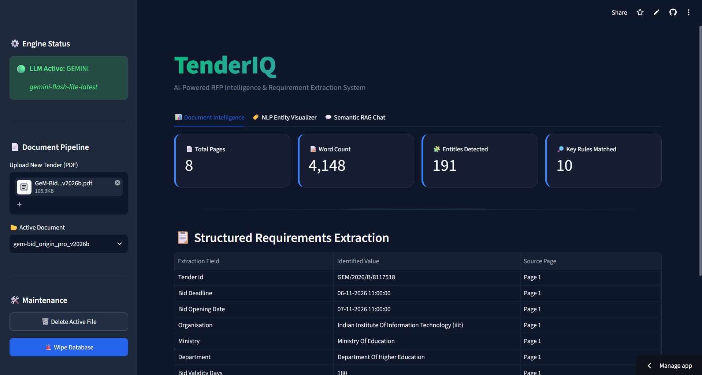
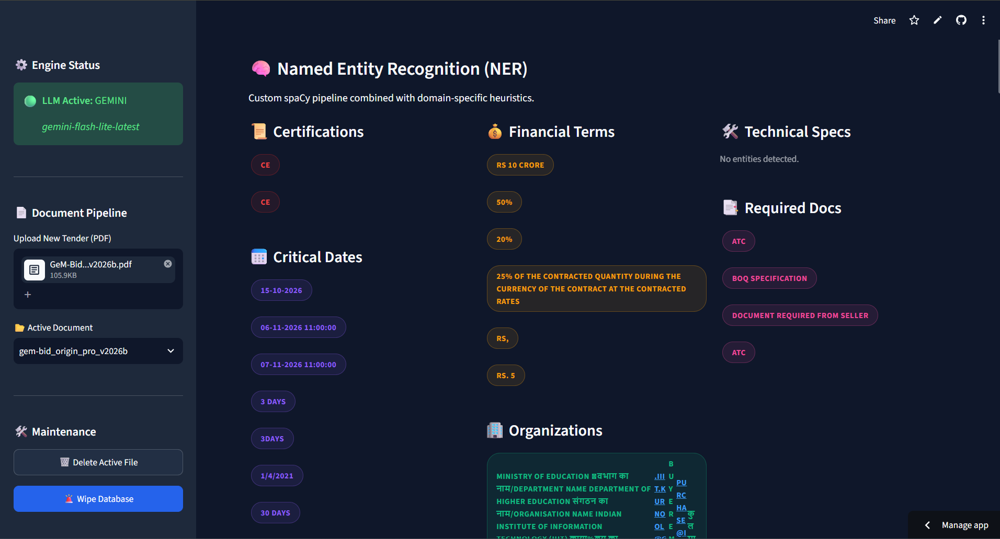
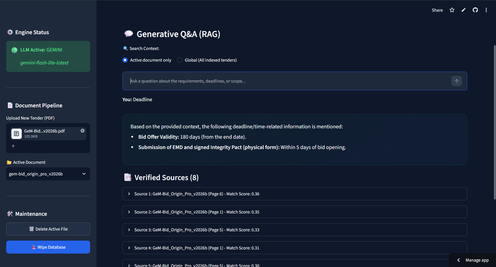
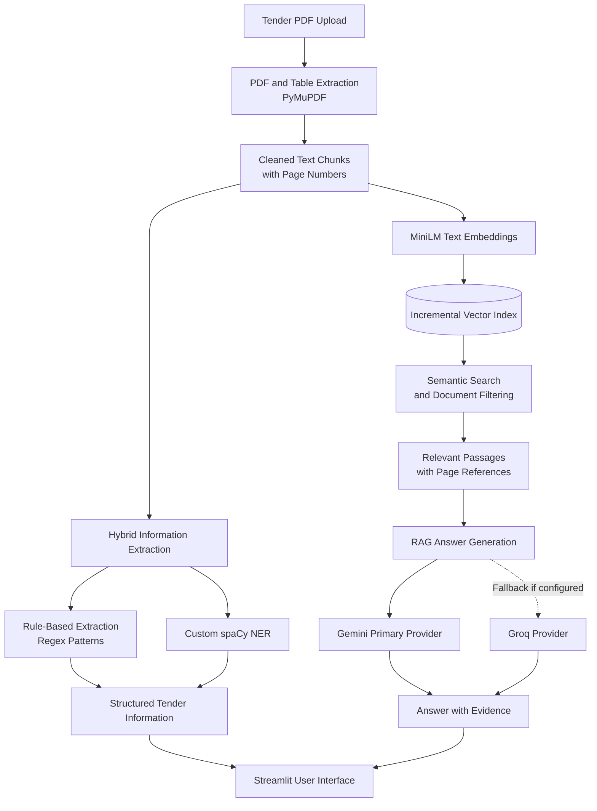

 <div align="center">

  <h1>🚀 TenderIQ</h1>
  <h3>AI-Powered Tender Intelligence & QA System</h3>

  <p><em>An end-to-end NLP capstone featuring custom spaCy NER, hybrid rule extraction, page-aware semantic search, and RAG-grounded question answering.</em></p>

  <p>
    <a href="https://github.com/Cosmic-Sangam/Tender-IQ"></a>
    <a href="https://spacy.io/"></a>
    <a href="https://ai.google.dev/"></a>
    <a href="https://tender-iq.streamlit.app"></a>
    <a href="https://opensource.org/licenses/MIT"></a>
  </p>

  <p><b>Extract • Understand • Answer</b> — <i>grounded intelligence from real tender and RFP documents.</i></p>

  <p>
    🌐 <b>Live Demo:</b> <a href="https://tender-iq.streamlit.app">Launch TenderIQ</a>
    &nbsp; • &nbsp;
    📦 <b>Repository:</b> <a href="https://github.com/Cosmic-Sangam/Tender-IQ">GitHub</a>
  </p>

</div>

---

## 📖 Table of Contents

- [✨ Introduction](#-introduction)
- [🚀 Live Demo](#-live-demo)
- [🖥️ Application Preview](#️-application-preview)
- [🎯 Key Features](#-key-features)
- [🏷️ Entity Schema](#️-entity-schema-custom-ner)
- [🏗️ System Architecture](#️-system-architecture)
- [🔄 How It Works](#-how-it-works)
- [🛠️ Tech Stack](#️-tech-stack)
- [📂 Project Structure](#-project-structure)
- [⚙️ Installation](#️-installation)
- [🧪 Testing](#-testing)
- [🔐 Security and Privacy](#-security-and-privacy)
- [⚠️ Limitations](#️-limitations)
- [🔮 Future Improvements](#-future-improvements)
- [📄 License](#-license)

---

## ✨ Introduction

**TenderIQ** is an end-to-end Natural Language Processing (NLP) system that transforms complex government and enterprise tender PDFs into structured, searchable, and answerable knowledge bases.

Tender documents can contain hundreds of pages of eligibility criteria, financial requirements, technical specifications, deadlines, certifications, and penalties. Finding specific information manually can be time-consuming and error-prone.

TenderIQ streamlines this process through a combination of information extraction, semantic search, and Retrieval-Augmented Generation (RAG).

### The workflow

1. Upload a tender PDF.
2. Extract important information using custom Named Entity Recognition (NER) and rule-based patterns.
3. Index document content for semantic retrieval.
4. Ask questions about the tender in natural language.
5. Receive answers grounded in retrieved document passages, with page-level evidence to help verify the information.

Built as an NLP capstone project, TenderIQ integrates a custom-trained spaCy NER model, hybrid information extraction, local text embeddings, semantic retrieval, and language-model-based question answering.

---

## 🚀 Live Demo

**Experience TenderIQ directly in your browser.**

<p align="center">
  <a href="https://tender-iq.streamlit.app">
    
  </a>
</p>

<p align="center">
  <a href="https://tender-iq.streamlit.app"><strong>🌐 Launch Live Application →</strong></a>
</p>

<p align="center">
  <a href="https://github.com/Cosmic-Sangam/Tender-IQ"><strong>📦 Explore the Source Code</strong></a>
</p>

### What can you explore?

- Extract tender-specific entities such as deadlines, certifications, and financial requirements.
- Search tender documents using natural-language queries.
- Ask questions about tender requirements.
- Inspect supporting passages and page references for generated answers.
- Explore document-specific and broader search options where available.

The hosted application's functionality depends on the current deployment and its configured services.

---

## 🖥️ Application Preview

The following screenshots showcase the TenderIQ interface and its core workflows.

### 1. Dashboard

<p align="center">
  
</p>

<p align="center"><em>The main interface for interacting with tender documents and the application's features.</em></p>

### 2. Entity Extraction

<p align="center">
  
</p>

<p align="center"><em>Identifying structured information such as eligibility criteria, deadlines, certifications, and financial requirements.</em></p>

### 3. Grounded Question Answering

<p align="center">
  
</p>

<p align="center"><em>Answering natural-language questions using retrieved document evidence and page references.</em></p>

<p align="center">
  <strong><a href="https://tender-iq.streamlit.app">Try these features in the live application →</a></strong>
</p>

---

## 🎯 Key Features

| Feature | Description |
|---|---|
| 📄 **PDF Text Extraction** | Uses PyMuPDF-based processing to extract tender content while preserving page information. |
| 📊 **Table-Aware Processing** | Supports processing of table content and document layouts as implemented in the extraction pipeline. |
| 🧠 **Custom spaCy NER** | Uses a domain-specific model trained to identify tender-related entities. |
| ⚖️ **Hybrid Extraction Engine** | Combines regex-based rules with NER predictions to extract structured information. |
| 🔍 **Semantic Search** | Uses `all-MiniLM-L6-v2` embeddings and cosine similarity for semantic retrieval. |
| 📚 **RAG Question Answering** | Uses Gemini as the primary generation provider and Groq as a fallback where configured. |
| 📎 **Page-Level Evidence** | Presents source passages and page references to help users verify answers. |
| 🎛️ **Document Scope Filter** | Supports document-specific or broader repository search, depending on the selected mode. |
| ⚡ **Incremental Embeddings** | Reuses existing embeddings where possible to avoid unnecessary re-encoding. |
| 🌙 **Interactive Streamlit UI** | Provides a user interface with theme options and presentation-oriented features. |

---

## 🏷️ Entity Schema (Custom NER)

The custom spaCy NER model is designed to identify the following tender-specific entity categories.

| Entity Label | Description |
|---|---|
| `CERTIFICATION` | Required certifications, standards, and compliance credentials |
| `FINANCIAL_REQUIREMENT` | Financial criteria and monetary requirements |
| `DEADLINE` | Submission deadlines and other important dates |
| `TECHNICAL_REQUIREMENT` | Technical specifications and conditions |
| `EXPERIENCE` | Prior experience and work-history criteria |
| `PENALTY` | Penalties and liquidated damages |
| `DOCUMENT` | Required supporting documents |
| `ELIGIBILITY` | Bidder qualification and eligibility conditions |
| `ORGANISATION` | Organizations and related entities |

### Why hybrid extraction?

Tender documents contain both predictable patterns and context-dependent information.

- **Rule-based extraction:** Useful for information that follows recognizable patterns, such as dates, amounts, and certain requirement formats.
- **Custom NER:** Useful for identifying domain-specific entities based on the surrounding text.
- **Hybrid pipeline:** Combines both approaches to provide complementary extraction methods.

Extraction results still depend on document quality, rule coverage, and model performance.

---

## 🏗️ System Architecture

The following diagram illustrates the main document-processing and question-answering pipeline.



---

## 🔄 How It Works

### 1. Document ingestion

The system accepts tender PDF documents and extracts their text using the PDF-processing pipeline.

### 2. Text cleaning and chunking

Extracted content is cleaned and organized into manageable text chunks. Page information is retained so that retrieved passages can be traced back to their source.

### 3. Hybrid entity extraction

The extraction pipeline combines two approaches:

- Regex-based rules for predictable text patterns.
- Custom spaCy NER for identifying tender-specific entities.

The resulting information can be used to inspect important requirements without manually scanning the entire document.

### 4. Semantic indexing

The system generates text embeddings using `all-MiniLM-L6-v2`. These embeddings represent document passages in a numerical vector space, allowing semantically related passages to be retrieved even when the query does not use the exact same wording.

### 5. Semantic retrieval

A user's question is converted into an embedding and compared against indexed document passages using cosine similarity. The configured document scope determines which passages are eligible for retrieval.

### 6. RAG-based answer generation

Relevant passages are provided as context to the configured language model. Gemini is the primary provider, with Groq available as a fallback where implemented and configured.

### 7. Evidence presentation

The interface displays the generated answer alongside supporting document evidence and page references, helping users verify the result against the original tender.

---

## 🛠️ Tech Stack

| Technology | Purpose |
|---|---|
| Python | Core implementation |
| spaCy | Custom Named Entity Recognition |
| PyMuPDF | PDF text extraction |
| Sentence Transformers | Text embedding generation |
| `all-MiniLM-L6-v2` | Semantic text representations |
| Cosine Similarity | Similarity-based retrieval |
| Gemini API | Primary answer-generation provider |
| Groq API | Configured fallback provider |
| Streamlit | Interactive web application |
| pytest | Automated testing |

---

## 📂 Project Structure

```text
Tender-IQ/
├── data/
│   ├── raw_pdfs/
│   └── extracted/
├── models/
│   └── tender_ner_v1/
├── src/
│   ├── pdf_extractor.py
│   ├── text_cleaner.py
│   ├── rule_extractor.py
│   ├── ner_predictor.py
│   ├── hybrid_pipeline.py
│   ├── embeddings.py
│   ├── semantic_search.py
│   └── rag.py
├── docs/
│   └── assets/
│       ├── dashboard.png
│       ├── entity-extraction.png
│       └── grounded-qa.png
├── tests/
├── streamlit_app.py
├── run_day1.py
├── run_day2.py
├── run_day3.py
├── run_day4.py
├── run_day5.py
├── run_day6.py
├── requirements.txt
├── runtime.txt
└── .streamlit/
    └── config.toml
```

*This is the documented project layout. Ensure the filenames match the current repository before using this tree as an exact inventory.*

---

## ⚙️ Installation

Follow these steps to run TenderIQ locally.

### Prerequisites

- Python 3.11 is recommended to match the project's `runtime.txt`.
- Git
- API credentials for the language-model providers you intend to use

### 1. Clone the repository

```bash
git clone https://github.com/Cosmic-Sangam/Tender-IQ.git
cd Tender-IQ
```

### 2. Create a virtual environment

**Windows PowerShell**

```powershell
python -m venv nlp_env
.\nlp_env\Scripts\Activate.ps1
```

**macOS / Linux**

```bash
python3 -m venv nlp_env
source nlp_env/bin/activate
```

### 3. Install dependencies

```bash
python -m pip install --upgrade pip
pip install -r requirements.txt
```

If the application requires spaCy's standard English pipeline, install it using:

```bash
python -m spacy download en_core_web_sm
```

The custom TenderIQ NER model is separate from this standard English model.

### 4. Configure environment variables

Create a `.env` file in the project root and add the API keys required by your configuration.

```env
GEMINI_API_KEY=your_gemini_api_key
GROQ_API_KEY=your_groq_api_key
```

Replace the placeholder values with your own credentials. Keep `.env` out of version control, and never publish API keys in the README or source code.

### 5. Launch the application

```bash
streamlit run streamlit_app.py
```

Open the local URL printed in your terminal.

### Optional: Run the development pipeline

The repository contains staged scripts named `run_day1.py` through `run_day6.py`. Follow the intended sequence and any prerequisites documented in those scripts.

---

## 🧪 Testing

Run the test suite from the project root:

```bash
pytest -v
```

This executes the tests available in the repository. Actual results depend on the current code, environment, installed dependencies, and required configuration.

---

## 🔐 Security and Privacy

- Store API keys in environment variables rather than committing them to source control.
- Do not publish confidential tender documents or sensitive procurement information in a public repository.
- Review the privacy and data-retention implications of sending document excerpts to external language-model providers.
- Verify generated answers against the original tender and any official clarifications before making procurement decisions.

---

## ⚠️ Limitations

- Extraction quality depends on PDF structure, text quality, and document formatting.
- Scanned PDFs may require OCR if their content is not available as extractable text.
- Custom NER predictions can miss entities or identify incorrect spans.
- Rule-based patterns may need adjustments for different tender formats.
- Semantic search may retrieve relevant but incomplete passages.
- Language-model answers can contain errors, even when source context is supplied.
- API availability, rate limits, and configuration can affect question answering.

TenderIQ is intended to assist with tender analysis, not replace verification of the original procurement documents.

---

## 🔮 Future Improvements

- Expand the annotated tender dataset and improve NER performance.
- Evaluate entity extraction using precision, recall, and F1-score.
- Add OCR support for scanned tender documents.
- Improve extraction from complex tables and financial clauses.
- Evaluate semantic retrieval using Recall@K and Mean Reciprocal Rank (MRR).
- Add automated continuous integration and regression testing.
- Expand document-format support and retrieval filters.

---

## 📄 License

This project is intended to use the MIT License. Refer to the repository's `LICENSE` file for the actual license terms.

---

## 🔗 Project Links

- **Live Demo:** https://tender-iq.streamlit.app
- **GitHub Repository:** https://github.com/Cosmic-Sangam/Tender-IQ

<p align="center">
  <strong>TenderIQ — Extract. Understand. Answer.</strong>
</p>
